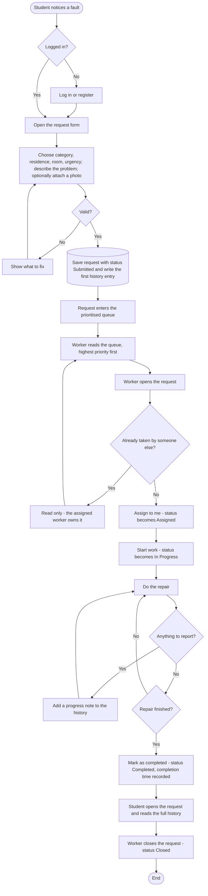

# Activity diagram - maintenance request workflow

From the moment a student notices a fault to the moment the repair is closed.

## Notes on the flow

- The only path into the queue is through validation, so no half-complete request is ever stored.
- The loop between *do the repair* and *add a progress note* is what the student actually sees
  while waiting; it is the difference between this and a WhatsApp message that disappears.
- The status can only move forward. The backend rejects any other jump, so the diagram is also
  the specification of `ALLOWED_TRANSITIONS` in `backend/src/utils/constants.js`.
