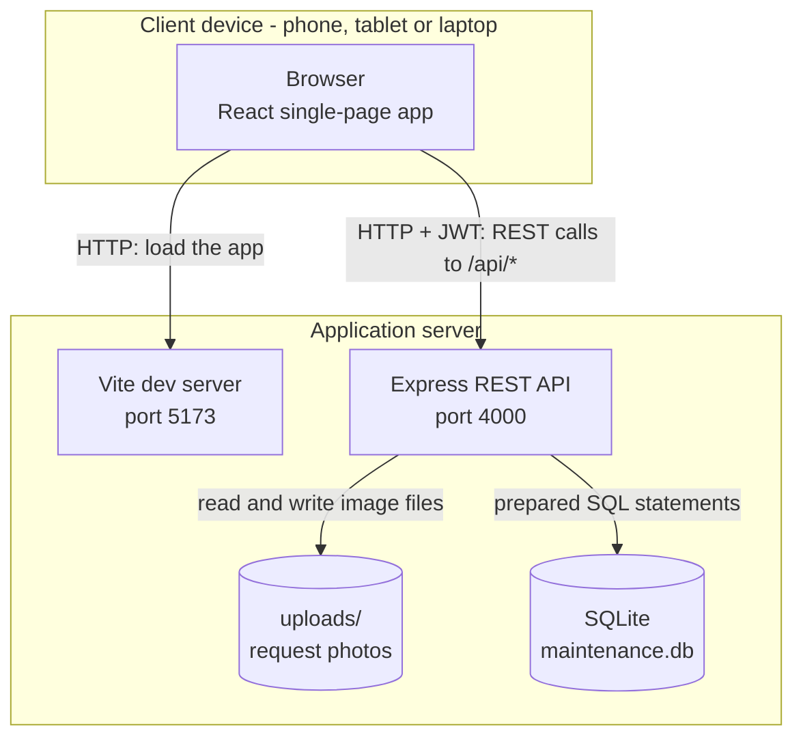
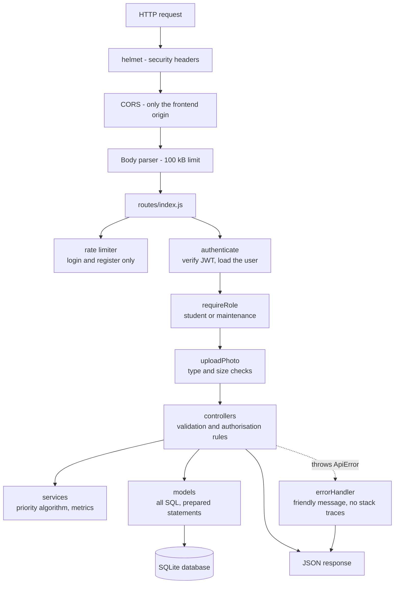
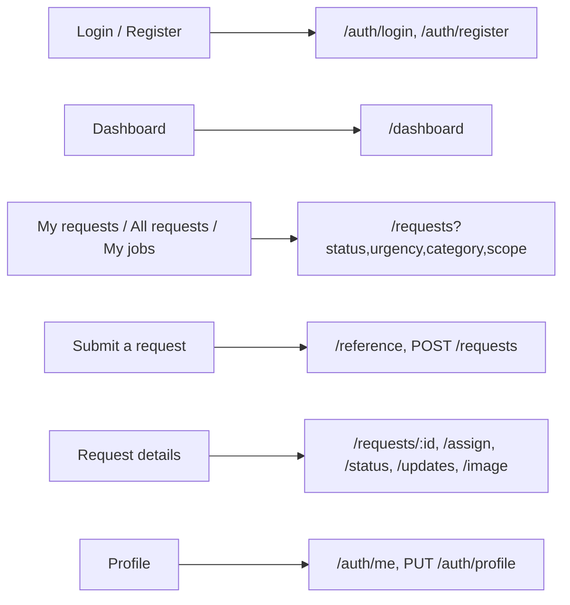

# System architecture diagram

## Deployment view

In production the Vite box disappears: the app is built to static files served by a reverse proxy
that also terminates HTTPS and forwards `/api/*` to the same Express process. See NETWORK.md.

## Layers inside the backend

Every arrow into `models` is a prepared statement, and every arrow out of `errorHandler` is a
short readable message. Those two facts are most of SECURITY.md in one picture.

## Screens and the endpoints behind them

