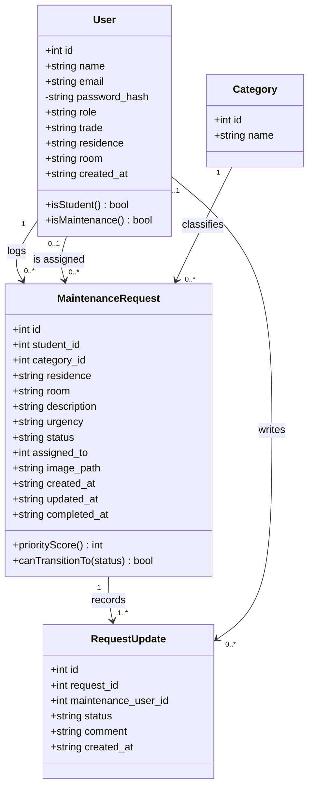
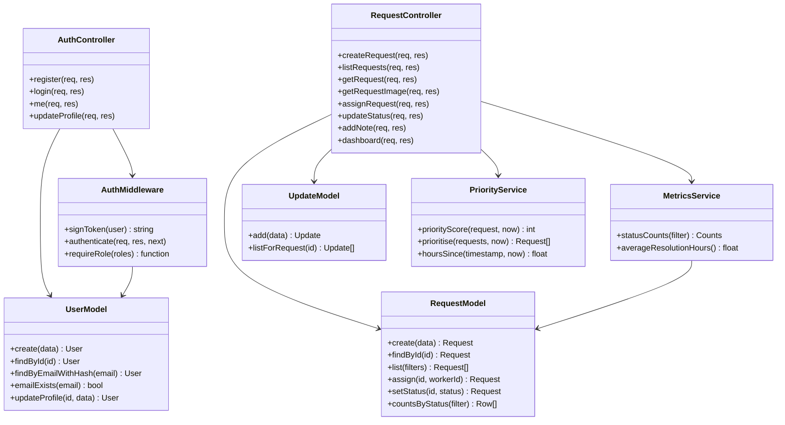
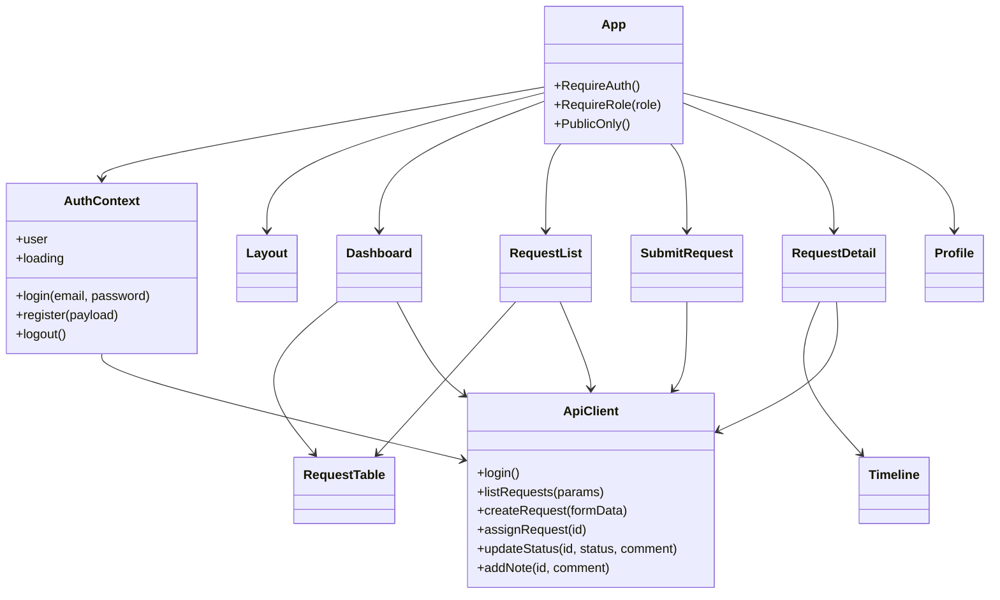

# Class diagram

The domain entities and the backend modules that operate on them.

## Backend modules

Note the direction of every arrow: controllers depend on models and services, and models depend
on the database. Nothing points back the other way, which is what keeps all the SQL in one layer
and all the authorisation rules in another.

## Frontend components

