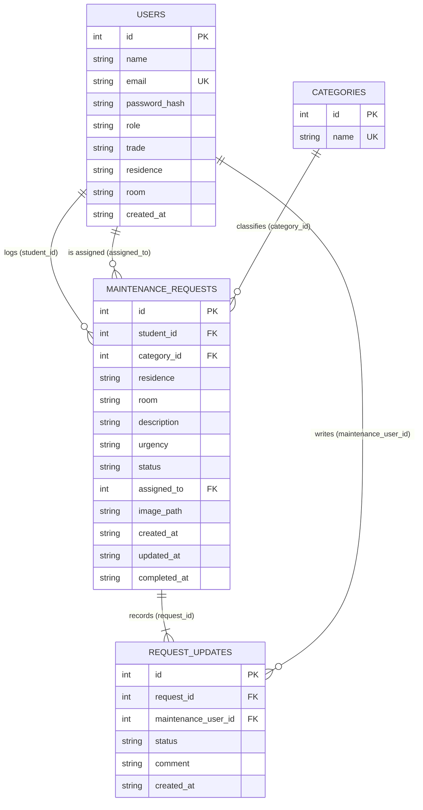

# Entity relationship diagram

## Reading the diagram

- `USERS ||--o{ MAINTENANCE_REQUESTS` twice: the same table is on both ends of two different
  relationships. A student **logs** many requests; a worker **is assigned** many requests. The
  second one is optional (`o{`) because a new request has no worker yet.
- `MAINTENANCE_REQUESTS ||--|{ REQUEST_UPDATES` uses `|{` (one-or-more) rather than `o{`: every
  request gets at least one history row the moment it is created.
- `CATEGORIES` is a lookup table, so the category list can change without editing existing
  requests.

Constraints, cascade rules and indexes are described in DATABASE.md.
