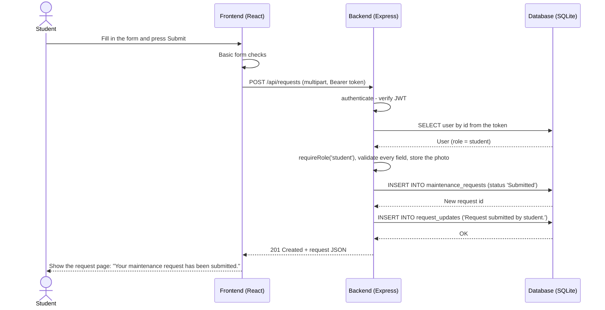
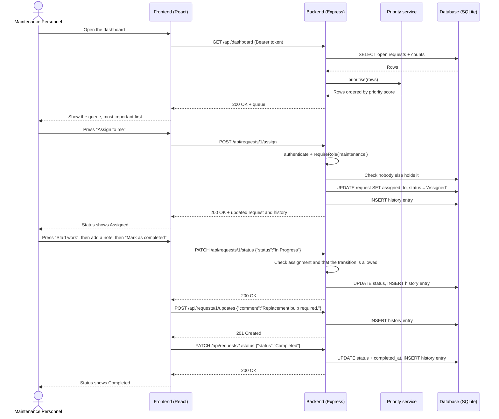
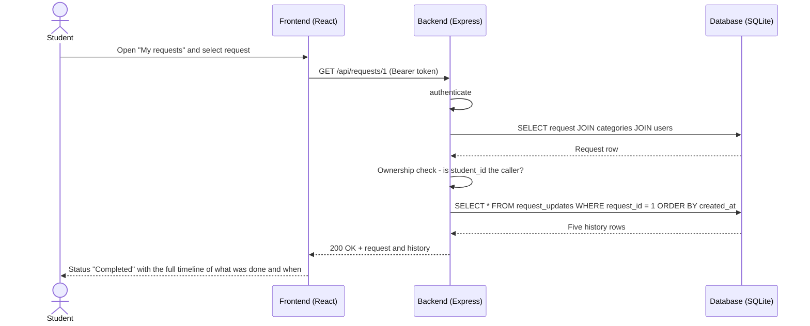

# Sequence diagrams

## 1. Student submits a request

## 2. Worker takes the job and completes it

## 3. Student sees the update

If the id had belonged to another student, the ownership check would have ended the sequence with
**404 Request could not be found** and no data would have been returned.
