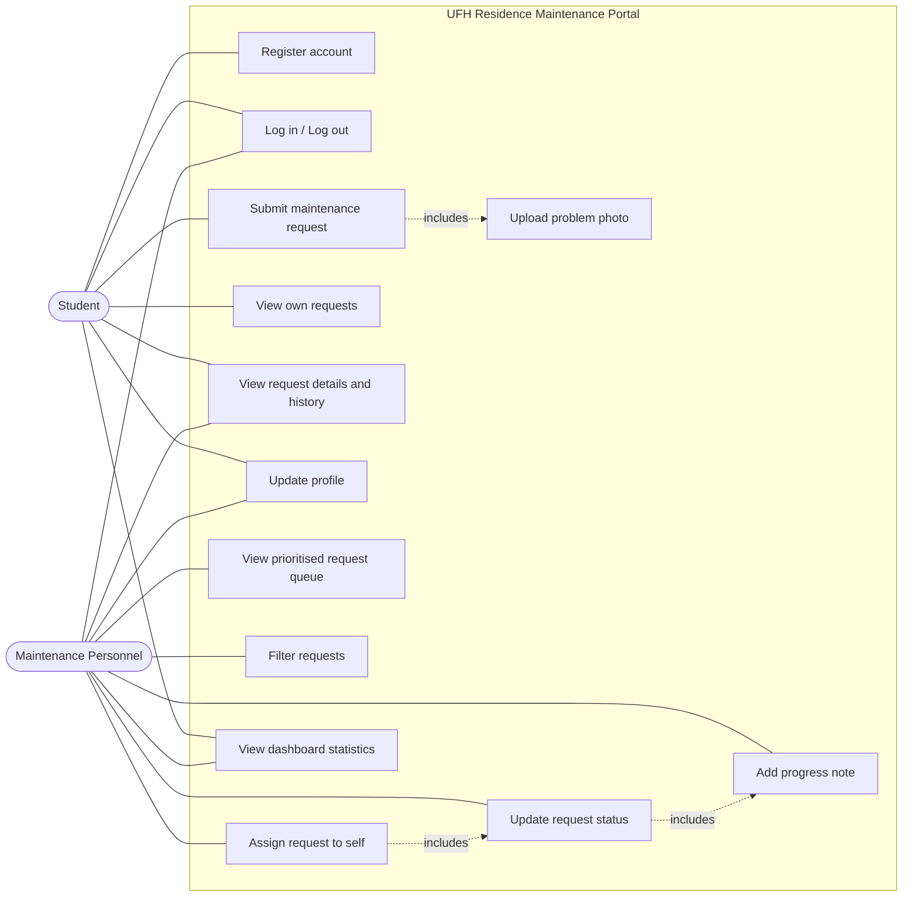

# Use case diagram

Two actors only: the **Student** who reports a problem and the **Maintenance Personnel** who fix
it. There is no administrator or help-desk actor, because the system itself is the link between
the two.

## Use case: Submit maintenance request

| | |
|---|---|
| **Actor** | Student |
| **Goal** | Report a fault in their residence room so it can be repaired |
| **Precondition** | The student is registered and logged in |
| **Main flow** | 1. Student opens the request form. 2. Chooses a category. 3. Confirms residence and room. 4. Chooses urgency. 5. Types a description. 6. Optionally attaches a photo. 7. Submits. |
| **Postcondition** | The request is stored with status `Submitted`, a first history entry is written, and it appears in the maintenance queue |
| **Alternative** | Validation fails (description too short, wrong file type) - the form explains what to fix and nothing is saved |

## Use case: Attend to a request

| | |
|---|---|
| **Actor** | Maintenance Personnel |
| **Goal** | Take responsibility for a fault, repair it and record what happened |
| **Precondition** | The worker is logged in and an open request exists |
| **Main flow** | 1. Worker reads the prioritised queue. 2. Opens a request. 3. Assigns it to themselves (`Assigned`). 4. Starts work (`In Progress`). 5. Adds progress notes. 6. Marks it completed (`Completed`). |
| **Postcondition** | Status and `completed_at` are updated; every step is in the history the student can read |
| **Alternative** | Another worker already holds the request - the system refuses the assignment and says who has it |
